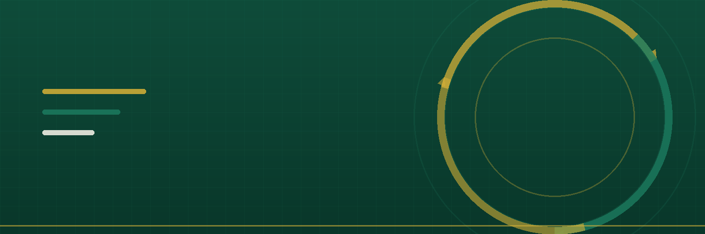

# Hayden Della Casa Alberighi

**Co-founder & Director of Operations — [Circular Appliance Co.](https://circularappliances.com)**

Brisbane, Australia · [circularappliances.com](https://circularappliances.com) · [hayden@circularappliances.com.au](mailto:hayden@circularappliances.com.au)

---

## Currently

**Pre-launch.** Circular Appliance Co. is building a Brisbane workshop that intercepts repairable washing machines and dryers before landfill, restores them to a published safety standard, and supplies them at fair prices — with the repair bench doubling as a paid pathway into the trades.

We are seeking founding **supply, distribution and capability partners** for a 50-unit supply trial. If you manage a waste stream, a housing portfolio, a training pathway or a funding program, I would like to talk.

[Read the prospectus](https://circularappliances.com/prospectus) · [Pilot brief (printable)](https://circularappliances.com/pilot-brief) · [Impact methodology](https://circularappliances.com/impact-methodology)

---

## What I do

| | |
| :--- | :--- |
| **Operations** | Workshop design and WHS, collection logistics, inventory, parts and salvage — everything between a machine arriving and a warrantied appliance leaving the floor. |
| **Safety & quality** | Designed the system so a unit cannot be listed without a passed electrical safety test, a named sign-off and a serial-linked history. The software refuses the release; it is not left to a manual. |
| **Engineering** | Designed and built the public website, operations dashboard, trainee portal and integration hub — from data model and access control through to deployment. |
| **Training pathway** | Structured the repair bench as a staged, supervised and paid pathway, with hours, assessments and sign-offs recorded against real work. |

---

## The work

### Circular Appliance Co.

One codebase, three surfaces, one database:

- **Public website** — shop with concession and retail pricing, collection bookings with indicative pilot slots, referral pathways, a self-service customer portal, impact reporting with a published methodology, and a prospectus that prints cleanly to PDF.
- **Operations dashboard** — intake, triage, repair logs, electrical safety records, listings, sales, reservations, warranty claims, parts, trainee hours, partners and closed impact periods.
- **Platform** — Next.js 16 on Cloudflare Workers, Prisma with D1, hashed API keys, typed server actions, encrypted integration credentials, and hand-written Vitest coverage over the domain rules.

A few decisions worth stating:

- Money is integer cents in AUD; enum-like values are validated strings; JSON is stored as text.
- Concession evidence records card type and date sighted — never the card number.
- Published impact figures come from operating records; closed periods are frozen so historical numbers never move.
- Rate limits fail open. A misconfigured binding must never block a customer or a webhook.

### Elsewhere

Private repositories cover experiments in delivery copilots, local AI infrastructure, workflow automation and case-management tooling. I keep them private until there is something worth showing — or until the question they answer is worth publishing.

---

## How I work

| Principle | The test |
| :--- | :--- |
| **Safety first** | A second-hand appliance in a low-income household must be as safe as a new one. The gate is in the state machine. |
| **Access, not credit** | A working machine should not depend on access to credit. No credit checks, no compounding interest. |
| **Honest measurement** | Report what was actually achieved, including shortfalls. Modelled figures are labelled as modelled; zeros are published as zeros. |
| **Build for the operator** | If a process only works because someone remembers to do it, it is not finished. |

---

## Contact

Partnerships, procurement, research collaborations or a good question about the model:

[circularappliances.com/contact](https://circularappliances.com/contact) · [hayden@circularappliances.com.au](mailto:hayden@circularappliances.com.au)

Brisbane, Australia · Built with care · All rights reserved

